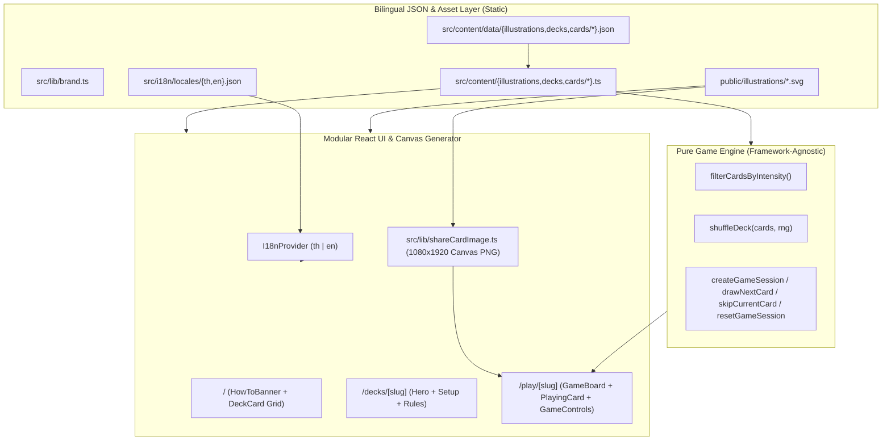

# Architecture Document — Icebreaker Club

## 1. ภาพรวมสถาปัตยกรรม (High-Level Overview)

Icebreaker Club พัฒนาด้วย **Next.js 15 (App Router)**, **TypeScript (Strict Mode)** และ **Tailwind CSS v4** โดยออกแบบให้เป็น **Static / Client-Side Hybrid Architecture** ที่ไม่ต้องพึ่งพาฐานข้อมูลหรือเซิร์ฟเวอร์ประมวลผลเบื้องหลัง ทำให้โหลดเร็ว ทนทานต่อทราฟฟิกสูง และโฮสต์บนบริการ Free Tier ได้อย่างสมบูรณ์



---

## 2. โครงสร้างโฟลเดอร์ (Directory Structure)

```text
src/
  app/
    layout.tsx                        # Root layout, Noto Sans Thai font, I18nProvider, SEO metadata
    page.tsx                          # Home Page (HowToBanner + 3 DeckCard covers)
    not-found.tsx                     # Custom 404 page (Bilingual)
    sitemap.ts                        # Dynamic sitemap generation
    robots.ts                         # Dynamic robots.txt generation
    decks/[slug]/page.tsx             # Deck Detail & Game Setup Page
    play/[slug]/page.tsx              # Playing Screen wrapper & metadata
  components/
    layout/
      Header.tsx                      # Top navigation with brand identity & LanguageSwitcher
      LanguageSwitcher.tsx            # Instant TH | EN locale toggle
      HowToBanner.tsx                 # Minimal 3-step how-to pill banner
      Footer.tsx                      # Minimal editorial footer
    deck/
      BackToHomeLink.tsx              # Localized back link on deck detail page
      DeckCard.tsx                    # Tactile deck cover card on Home Page
      DeckOverviewHero.tsx            # Deck overview hero on /decks/[slug]
      DeckSetupPanel.tsx              # Interactive intensity selector & start button
      DeckRulesCard.tsx               # Localized how-to-play steps & safety notice
      ShareDeckButton.tsx             # Web Share API + Clipboard fallback button
    game/
      GameBoard.tsx                   # Game session state controller
      PlayingCard.tsx                 # Physical stacked deck stage wrapper
      PlayingCardBack.tsx             # Unrevealed card back (constant height)
      PlayingCardFront.tsx            # Revealed card front (constant height, 4-line clamp)
      GameControls.tsx                # Skip, Reveal/Next, Reshuffle, and Save Story Card controls
      ShareCardStoryButton.tsx        # Button to generate & download 1080x1920 Story card PNG
      RoundCompleteView.tsx           # End-of-round summary & replay screen
      EmptyDeckView.tsx               # Empty filter fallback screen
      __tests__/
        userFlow.test.tsx             # Integration tests for flows, i18n, and Thai text wrapping
    ui/
      CardIllustration.tsx            # Reusable SVG renderer with localized alt text
  features/
    game/
      shuffle.ts                      # Fisher-Yates shuffle with injectable RNG
      drawCard.ts                     # Pure functions for drawing, skipping, and remaining count
      gameState.ts                    # Session state machine (ready, playing, completed, empty)
      __tests__/
        gameEngine.test.ts            # Unit tests for all game engine functions
  i18n/
    I18nProvider.tsx                  # React Context provider & useI18n() hook
    locales/
      th.json                         # Thai UI dictionary
      en.json                         # English UI dictionary
  content/
    data/
      illustrations.json              # 24 bilingual illustration definitions
      decks.json                      # 3 bilingual deck definitions
      cards/
        get-to-know.json              # 32 bilingual cards for Get to Know deck
        couples.json                  # 32 bilingual cards for Couples deck
        party-drinks.json             # 32 bilingual cards for Party & Drinks deck
    illustrations.ts                  # Typed illustration registry & lookup helper
    decks.ts                          # Typed deck registry & lookup helper
    cards/
      get-to-know.ts                  # Typed export for Get to Know cards
      couples.ts                      # Typed export for Couples cards
      party-drinks.ts                 # Typed export for Party & Drinks cards
      index.ts                        # Unified card registry and lookup helpers
  lib/
    brand.ts                          # Decoupled brand configuration
    url.ts                            # Safe base URL helper for SEO metadata
    shareCardImage.ts                 # HTML5 Canvas 2D Story card PNG generator (1080x1920)
  types/
    game.ts                           # Strict TypeScript definitions
public/
  illustrations/                      # 24 hand-drawn black & white SVG assets (< 1 KB each)
scripts/
  validate-assets.mjs                 # Validation for SVG budgets and bilingual JSON card data
```

---

## 3. การออกแบบ Game Engine (`src/features/game/`)

Game Engine ถูกแยกออกจาก React อย่างเด็ดขาด (Pure TypeScript Functions) เพื่อให้ทดสอบได้ 100% และนำกลับมาใช้ใหม่ได้ง่าย:

1. **Deterministic & Testable Shuffle (`shuffle.ts`)**:
   - ใช้อัลกอริทึม **Fisher–Yates Shuffle** แบบไม่แก้ไข Array ต้นฉบับ (Immutable)
   - รับพารามิเตอร์ `rng: RngFunction = defaultRng` เพื่อให้ Unit Test สามารถส่ง `createSeededRng(seed)` เข้ามาทดสอบได้
2. **Intensity Filtering (`drawCard.ts`)**:
   - กรองไพ่ตามระดับความเข้มข้น (`all` หรือ `1` | `2` | `3`) **ก่อน** นำเข้าสู่กระบวนการสับไพ่
3. **Session State Machine (`gameState.ts`)**:
   - เก็บรายการไพ่ที่สับแล้ว (`cards`), ดัชนีปัจจุบัน (`currentIndex`), สถานะการหงายไพ่ (`isCurrentCardRevealed`), รายการไพ่ที่เปิดอ่านแล้ว (`playedCardIds`), และรายการไพ่ที่ข้าม (`skippedCardIds`)
   - **การเปิดไพ่ (`drawNextCard`)**: ห้ามเปิดเผยข้อมูลไพ่ใบถัดไปในสถานะยังไม่เปิด (`getVisibleCurrentCard` คืนค่า `null` เมื่อ `isCurrentCardRevealed === false`) และไม่มีการสุ่มซ้ำภายในรอบเดียวกัน
   - **การข้ามไพ่ (`skipCurrentCard`)**: บันทึกรหัสไพ่ที่ข้ามลงใน `skippedCardIds` และเลื่อนไปยังใบถัดไปโดยไม่นำไพ่ที่ข้ามกลับมาในรอบเดิม
   - **การเริ่มรอบใหม่ (`resetGameSession`)**: สับไพ่ชุดที่กรองไว้ใหม่อีกครั้ง เพิ่มเลขรอบ (`round + 1`) และรีเซ็ตตัวนับทั้งหมดโดยไม่ต้องรีโหลดหน้าเว็บ

---

## 4. ระบบ i18n และการสร้างรูปการ์ดสำหรับโซเชียล

1. **Hydration-Safe Bilingual i18n (`src/i18n/`)**:
   - ใช้ `I18nProvider` ที่มีค่าเริ่มต้นเป็นภาษาไทย (`th`) ทั้งฝั่ง Server และ Client ตอน Hydration จึงไม่เกิดปัญหา Hydration Mismatch
   - ผู้ใช้สามารถสลับภาษา `TH` / `EN` ได้ทันทีผ่าน `LanguageSwitcher` โดยไม่ต้องเปลี่ยน URL หรือรีโหลดหน้าเพจ (ทำให้สถานะเกมที่กำลังเล่นอยู่ไม่หลุดเมื่อสลับภาษา)
2. **Client-Side Story Card Image Generator (`src/lib/shareCardImage.ts`)**:
   - ใช้ HTML5 `<canvas>` ขนาด `1080×1920` (อัตราส่วน 9:16 สำหรับ IG Story) วาดพื้นหลัง กรอบการ์ด 3 มิติ ภาพประกอบ SVG ของไพ่ใบนั้น และข้อความคำถามหลักโดยตัดส่วนที่ไม่จำเป็นออก (ไม่มี Header ของการ์ด, ไม่มีกล่องชวนคุยต่อ, ไม่มี `#tags` และไม่มีรหัส ID ในการ์ด)
   - ใช้ `Intl.Segmenter` ตัดคำภาษาไทยและอังกฤษอย่างแม่นยำแม้มีช่องว่างคั่นประโยค พร้อมปรับขนาดฟอนต์อัตโนมัติให้พอดีกรอบการ์ดเสมอ
